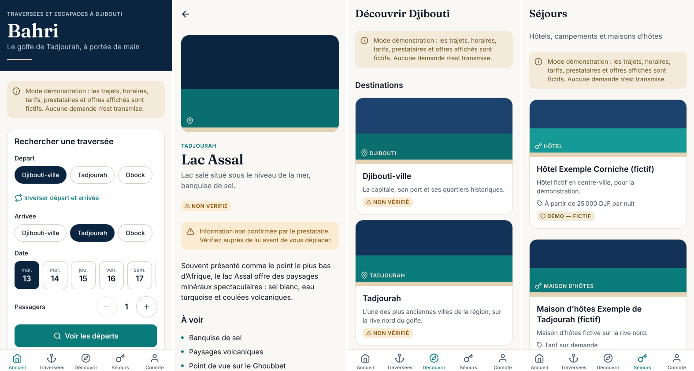

# Bahri — traversées et tourisme à Djibouti

Application mobile (Android et iOS, base de code unique) de mise en relation pour le transport maritime et le tourisme à Djibouti : traversées du golfe de Tadjourah, destinations, excursions, hébergements et prestataires locaux.

> **Nom provisoire.** « Bahri » (« maritime » en arabe) est un nom de travail. Vérifier sa disponibilité (marque, nom de domaine, boutiques d'applications) avant tout lancement.

> **Statut : prototype fonctionnel en mode démonstration.** Toutes les offres affichées (prestataires, trajets, horaires, tarifs, hébergements, excursions, annonces) sont **fictives** et signalées comme telles dans l'application. Les destinations sont des lieux réels, mais leurs descriptions ne sont **pas vérifiées**.

Bahri est une plateforme **indépendante d'intermédiation**. Elle n'est ni armateur, ni exploitant de lignes maritimes, ni hôtel, et ne détient aucune autorisation officielle à ce jour.



---

## Ce qui fonctionne aujourd'hui

| Domaine | État |
| --- | --- |
| Accueil (marque, recherche de traversée, destinations, excursions, hébergements, offre sponsorisée signalée) | ✅ |
| Traversées : recherche origine / destination / date / passagers, résultats, détail, places restantes | ✅ |
| Tourisme : destinations, excursions, circuits, activités, coordonnées du prestataire | ✅ |
| Hébergements : liste, fiche, demande | ✅ |
| Demande de réservation : formulaire validé, manifeste nominatif pour les traversées, confirmation avec référence, suivi, annulation | ✅ |
| Compte : historique des demandes, confidentialité, connexion par code e-mail (actif avec Supabase) | ✅ |
| Base de données Supabase : schéma, sécurité RLS, contrôle de capacité côté serveur, journal d'audit | ✅ (testée localement) |
| Tableau de bord d'administration web | 🟡 base de données et droits prêts ; interface à construire |
| Paiements | ⏸️ désactivés volontairement (voir [docs/paiements.md](docs/paiements.md)) |
| Notifications push | ⏸️ table `notifications` prête ; envoi push à brancher |

## Démarrage rapide

Prérequis : Node.js 20 ou plus récent, npm, et l'application **Expo Go** ou un *development build* sur votre téléphone.

```bash
npm install
npm start            # puis scanner le QR code avec le téléphone
npm run web          # aperçu dans le navigateur
```

Sans fichier `.env`, l'application démarre en **mode démonstration**. Pour la brancher sur Supabase, copier `.env.example` en `.env` et suivre [docs/supabase.md](docs/supabase.md).

## Commandes de qualité

```bash
npm run typecheck    # TypeScript strict
npm run lint         # ESLint (règles Expo + React Compiler)
npm test             # tests unitaires et d'interface (Jest)
npm run test:db      # tests SQL : migrations, RLS, réservations (PostgreSQL embarqué, sans serveur)
npm run check        # tout ce qui précède
```

## Structure

```
src/
  app/            Écrans (Expo Router : chaque fichier = une route)
  components/     Composants métier (cartes, recherche) et ui/ (système de design)
  data/           Accès aux données : interfaces, mode démo, adaptateur Supabase
  design/         Jetons du système de design (couleurs, typo, espacements)
  domain/         Règles métier pures : statuts de réservation, validation, formats
  i18n/           Traductions (fr, en)
supabase/
  migrations/     Schéma, sécurité (RLS), fonctions de réservation
  seed.sql        Données de démonstration (recette uniquement)
  tests/          Tests SQL exécutés avec PGlite
docs/             Architecture, juridique, paiements, budget, publication
assets/           Icônes et écran de démarrage
```

## Documentation

- [Architecture et choix techniques](docs/architecture.md)
- [Système de design](docs/design-system.md)
- [Mise en place de Supabase](docs/supabase.md)
- [Points juridiques et réglementaires à vérifier](docs/juridique.md)
- [Paiements et monétisation](docs/paiements.md)
- [Budget](docs/budget.md)
- [Compilation et publication Android / iOS](docs/publication.md)
- [Feuille de route](docs/feuille-de-route.md)
- [Projet de politique de confidentialité](docs/politique-confidentialite.md)

## Règles du projet

1. **Aucune donnée non vérifiée présentée comme vérifiée.** Chaque contenu porte un niveau de fiabilité : `demo`, `unverified` ou `verified`, affiché à l'écran.
2. **Aucune confirmation sans le serveur.** Une demande n'est affichée comme envoyée qu'après réponse positive ; elle n'est garantie qu'après confirmation du prestataire.
3. **Sécurité côté serveur.** Disponibilités, droits et transitions de statut sont contrôlés par la base de données, jamais uniquement par l'application.
4. **Aucun secret dans le dépôt.** Seule la clé *publique* Supabase peut figurer dans l'application.
5. **Contenus sponsorisés toujours signalés.**
